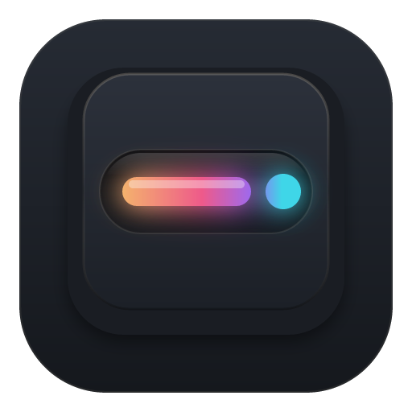
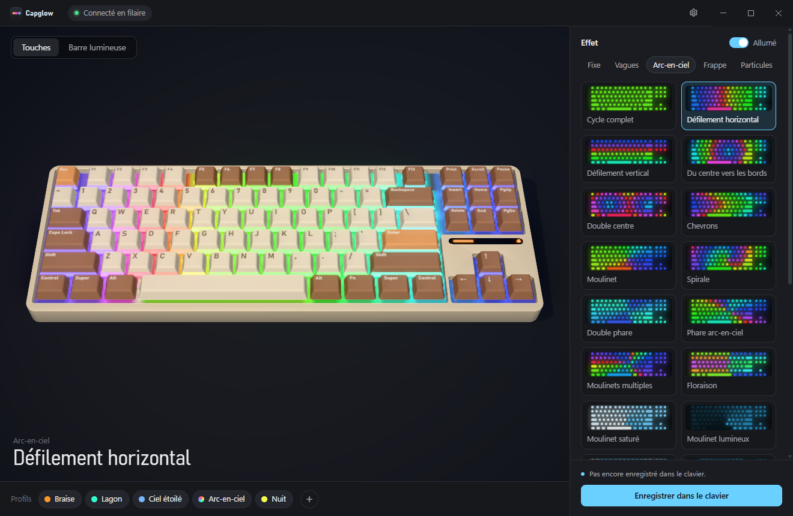
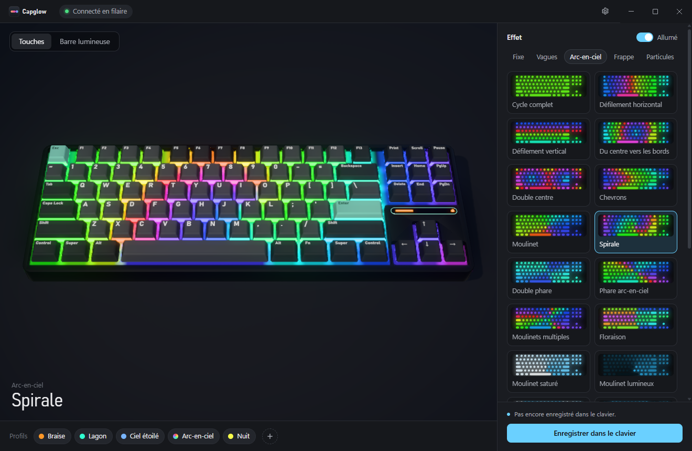
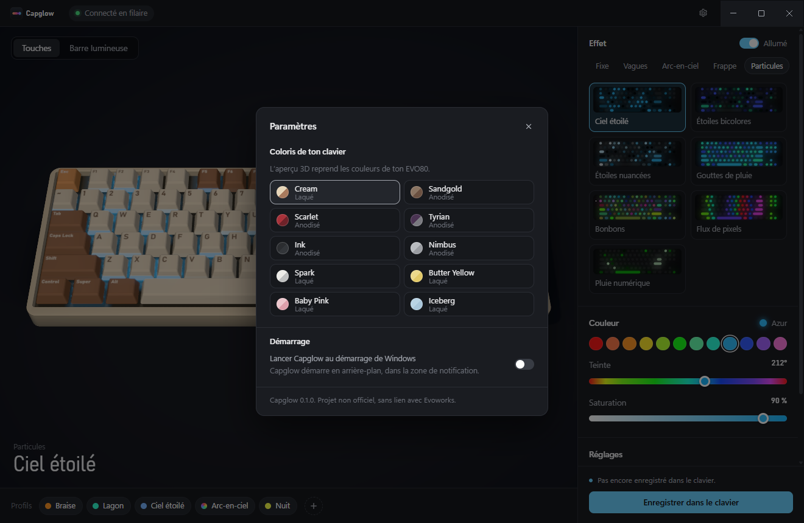

<p align="center">
  
</p>

<h1 align="center">Capglow</h1>

<p align="center">
  Une application Windows pour régler l'éclairage RGB des claviers mécaniques VIA,<br>
  sans passer par un configurateur web.
</p>

> Projet non officiel, sans lien avec Evoworks ni Weikav. « EVO80 », « Evoworks », « NUT65 » et « Weikav » sont des marques de leurs propriétaires respectifs.

<p align="center">
  
</p>

## Claviers pris en charge

Capglow reconnaît automatiquement le clavier branché.

| Clavier | État | Zones réglables |
| --- | --- | --- |
| Evoworks EVO80 | Testé | Touches et barre lumineuse |
| Weikav NUT65 | Expérimental, pas encore testé sur un vrai clavier | Touches (la barre en façade se règle au clavier) |

Sur un clavier expérimental, Capglow relit chaque réglage après l'avoir écrit et arrête d'écrire au moindre écart. Si tu as un NUT65, ton retour est précieux : exporte un diagnostic depuis les paramètres et [ouvre un ticket](../../issues/new).

## Ce que fait Capglow

- Aperçu 3D du clavier en temps réel, qui reproduit l'effet choisi.
- Tous les effets de rétroéclairage proposés par le firmware du clavier.
- Couleur, luminosité et vitesse, appliquées en direct au clavier.
- Enregistrement dans la mémoire du clavier : le look reste après un redémarrage.
- Profils enregistrés sur le PC, pour changer d'ambiance en un clic.
- Les coloris officiels de chaque clavier pour que l'aperçu ressemble au tien.

## Aperçu

| | |
| --- | --- |
|  |  |
| Les 10 coloris de l'EVO80, ici Ink avec l'effet Spirale | Ciel étoilé en bleu azur sur le coloris Iceberg |
|  |  |
| La caméra zoome sur la barre lumineuse quand on la règle | Coloris du clavier et lancement au démarrage de Windows |

## Prérequis

- Windows 10 ou 11.
- Le clavier **branché en filaire (USB-C)** : interrupteur sur la position câble pour l'EVO80, Fn + T pour le NUT65.
  Le dongle 2.4G et le Bluetooth ne permettent pas la configuration.

## Installation

Télécharge la dernière version dans l'onglet [Releases](../../releases) :

- **`Capglow-Setup-….exe`** : l'installateur. Il crée les raccourcis Bureau et menu Démarrer, et se désinstalle depuis « Applications installées ».
- **`Capglow-…-windows-x64.zip`** : si Windows bloque l'installateur. Extrais le zip, lance `Capglow.exe`, puis clique sur « Installer » : Capglow s'installe tout seul au même endroit, avec ses raccourcis.

Aucun pilote n'est nécessaire.

> **Pourquoi deux versions ?** L'application n'est pas signée numériquement. La plupart des PC affichent simplement un avertissement SmartScreen pour l'installateur (« Informations complémentaires », puis « Exécuter quand même »). Mais si Smart App Control est actif, Windows 11 bloque tout installateur non signé. `Capglow.exe`, lui, est le binaire Electron d'origine, non modifié, et passe ce contrôle : c'est pour ça que la version zip peut s'installer elle-même.

## Développement

```sh
npm install      # copie aussi Three.js dans src/vendor
npm start        # lance l'application
npm run dist     # génère l'installateur et le zip dans dist/
```

Sans le clavier sous la main, un clavier simulé répond aux commandes VIA comme le vrai :

```sh
CAPGLOW_SIMULATE=nut65 npm start
```

Le code est en JavaScript sans framework :

| Fichier | Rôle |
| --- | --- |
| `main.js` | Fenêtre Electron et autorisations WebHID |
| `src/hid.js` | Protocole VIA (QMK Raw HID) : lecture, écriture, sauvegarde |
| `src/effects.js` | Catalogue des effets et leur simulation pour l'aperçu |
| `src/keyboards/` | Une définition par clavier : identifiants USB, disposition, zones, effets, coloris, modèle 3D |
| `src/keyboard.js` | Couleurs des touches et vignettes des effets |
| `src/keyboard3d.js` | Rendu 3D (Three.js) |
| `src/simulator.js` | Clavier VIA simulé, pour le développement |
| `src/led.js` | Calibrage des couleurs des LED pour l'aperçu |
| `src/app.js` | Interface |
| `preload.js` | Réglages exposés à l'interface (démarrage, installation) |
| `installer.js` | Installation et désinstallation depuis la version zip |
| `scripts/vendor-three.js` | Copie de Three.js dans l'application |

### Protocole

Les claviers exposent l'interface VIA standard (page d'usage `0xFF60`, rapports de 32 octets). Capglow n'utilise que les commandes d'éclairage : `0x07` (écrire), `0x08` (lire) et `0x09` (enregistrer), et refuse d'écrire si le clavier annonce un protocole VIA antérieur à la version 11.

| Clavier | USB | Zone | Canal | Luminosité | Vitesse |
| --- | --- | --- | --- | --- | --- |
| EVO80 | `36B0:300E` | Touches | 3 (`rgb_matrix`) | 0 à 180 en écriture, lue sur 0 à 255 | 0 à 255 |
| EVO80 | | Barre lumineuse | 2 (`rgblight`) | 0 à 105 | 0 à 4 |
| NUT65 | `342D:E51A` | Touches | 3 (`rgb_matrix`) | 0 à 255 | 0 à 255 |

Pour ajouter un clavier : une définition dans `src/keyboards/` (voir `evo80.js`), son entrée dans `src/keyboards/index.js` et son identifiant constructeur dans `main.js`.

## Licence

[GPL-3.0](LICENSE). Tu peux utiliser, modifier et redistribuer Capglow, à condition de publier tes modifications sous la même licence.
