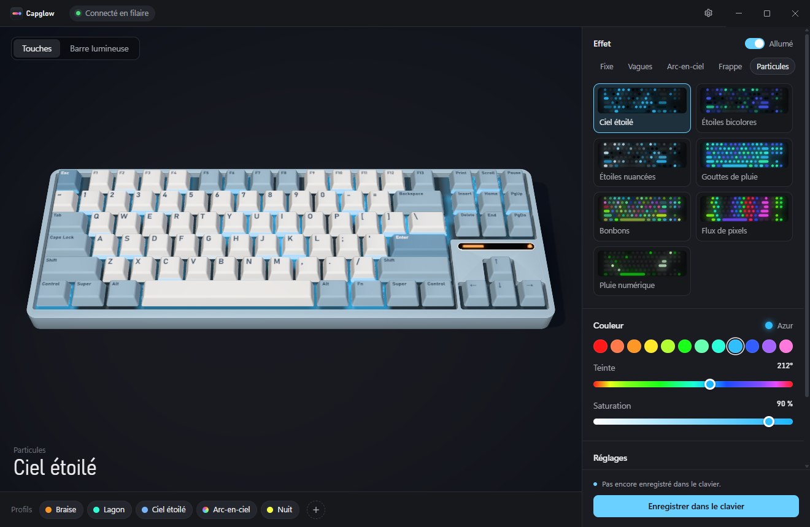
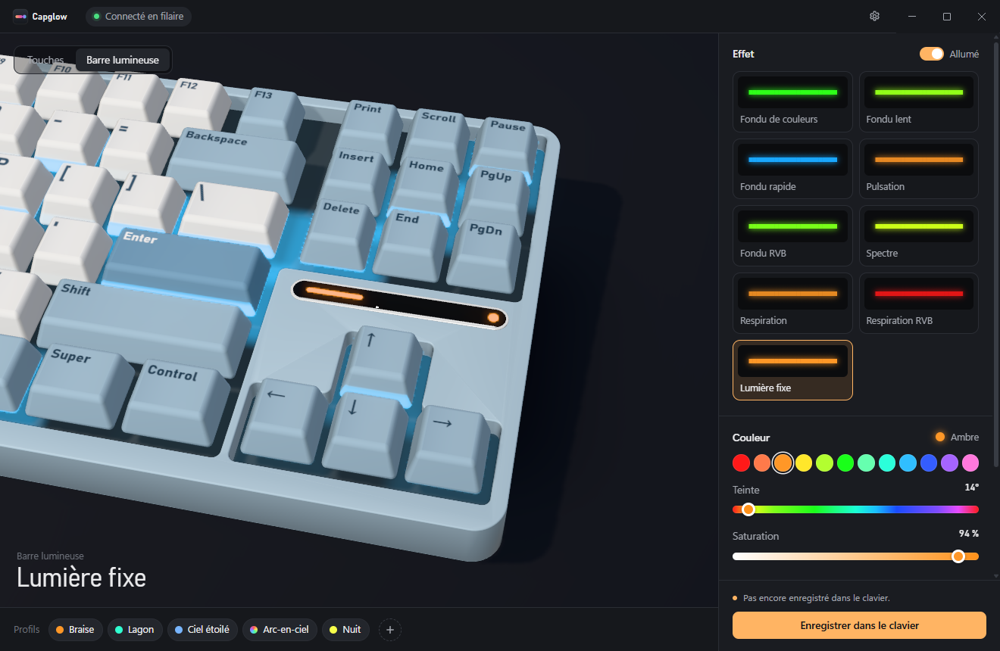

<p align="center">
  
</p>

<h1 align="center">Capglow</h1>

<p align="center">
  Une application Windows pour régler l'éclairage RGB du clavier <strong>Evoworks EVO80</strong>,<br>
  sans passer par un configurateur web.
</p>

> Projet non officiel, sans lien avec Evoworks. « EVO80 » et « Evoworks » sont des marques de leurs propriétaires respectifs.

<p align="center">
  
</p>

## Ce que fait Capglow

- Aperçu 3D du clavier en temps réel, qui reproduit l'effet choisi.
- Les 45 effets du rétroéclairage des touches et les 9 effets de la barre lumineuse.
- Couleur, luminosité et vitesse, appliquées en direct au clavier.
- Enregistrement dans la mémoire du clavier : le look reste après un redémarrage.
- Profils enregistrés sur le PC, pour changer d'ambiance en un clic.
- Les 10 coloris de l'EVO80 pour que l'aperçu ressemble à ton clavier.

## Aperçu

| | |
| --- | --- |
|  |  |
| Les 10 coloris de l'EVO80, ici Ink avec l'effet Spirale | Ciel étoilé en bleu azur sur le coloris Iceberg |
|  |  |
| La caméra zoome sur la barre lumineuse quand on la règle | Coloris du clavier et lancement au démarrage de Windows |

## Prérequis

- Windows 10 ou 11.
- Le clavier **branché en filaire (USB-C)**, interrupteur sur la position câble.
  Le dongle 2.4G et le Bluetooth ne permettent pas la configuration.

## Installation

Télécharge la dernière version dans l'onglet [Releases](../../releases), puis lance l'exécutable. Aucun pilote ni installation n'est nécessaire.

L'exécutable n'est pas signé numériquement. Windows peut donc afficher un avertissement SmartScreen (« Informations complémentaires », puis « Exécuter quand même »). Si Smart App Control est actif sur ton PC, il bloque les applications non signées : dans ce cas, lance Capglow depuis les sources (voir ci-dessous).

## Développement

```sh
npm install      # copie aussi Three.js dans src/vendor
npm start        # lance l'application
npm run dist     # génère l'exécutable portable dans dist/
```

Le code est en JavaScript sans framework :

| Fichier | Rôle |
| --- | --- |
| `main.js` | Fenêtre Electron et autorisations WebHID |
| `src/hid.js` | Protocole VIA (QMK Raw HID) : lecture, écriture, sauvegarde |
| `src/effects.js` | Catalogue des effets et leur simulation pour l'aperçu |
| `src/keyboard.js` | Disposition des touches et vignettes des effets |
| `src/keyboard3d.js` | Rendu 3D (Three.js) |
| `src/themes.js` | Coloris de l'EVO80 |
| `src/led.js` | Calibrage des couleurs des LED pour l'aperçu |
| `src/app.js` | Interface |
| `preload.js` | Réglages exposés à l'interface (lancement au démarrage) |
| `scripts/vendor-three.js` | Copie de Three.js dans l'application |

### Protocole

Le clavier expose l'interface VIA standard (page d'usage `0xFF60`, rapports de 32 octets) en filaire (`36B0:300E`).

| Zone | Canal | Luminosité | Effets | Vitesse |
| --- | --- | --- | --- | --- |
| Touches | 3 (`rgb_matrix`) | 0 à 180 en écriture, lue sur 0 à 255 | 0 à 45 | 0 à 255 |
| Barre lumineuse | 2 (`rgblight`) | 0 à 105 | 0 à 9 | 0 à 4 |

Les commandes utilisées sont `0x07` (écrire), `0x08` (lire) et `0x09` (enregistrer).

## Licence

[GPL-3.0](LICENSE). Tu peux utiliser, modifier et redistribuer Capglow, à condition de publier tes modifications sous la même licence.
